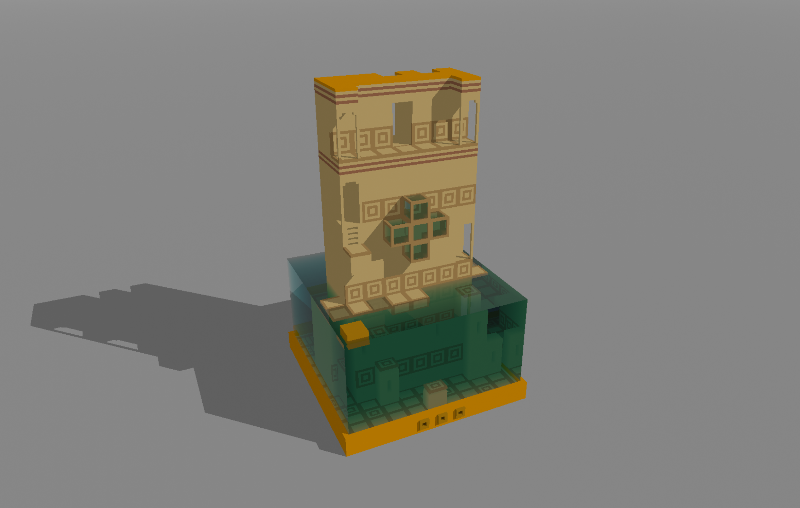
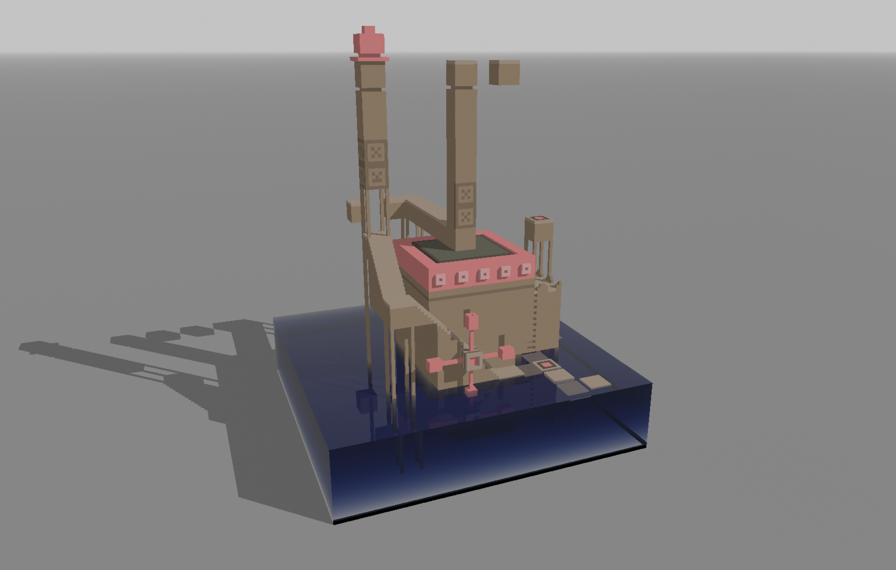

# Cuda Voxel Ray Marching

## Disclaimer: SUPPORT MAGICAL VOXEL!

The file format used (".vox") and inspiration for the render is from voxel editor program Magical Voxel. This project is for my own enjoyment and learning.

Please support the Magical Voxel creator **ephtracy** : https://ephtracy.github.io/ 

With regards to this project, unlike the original, I included refractions and reflections for glass materials using Whitted Ray Tracing so you can view them in real time in motion without noise.

This project's rendering is implemented entirely from scratch using C++, Cuda, and an older library I made called "crrt" using OpenGL even though I used the ".vox" models.

**crrt**: https://github.com/AustinTackett/crrt

## Renders

I DID NOT MAKE THESE MODELS, AND THUS THEY ARE NOT INCLUDED IN THE REPOSITORY.

Models can be found in the official "voxel-model" repository associated with Magica Voxel.

Model Repository: https://github.com/ephtracy/voxel-model

Model 1: voxel-model/vox/monu6.vox 

Model 2: voxel-model/vox/monu8.vox

Edits: Changed blue diffuse water to blue-ish transparent glass materials in Magica Voxel within monu6 and monu8.

### Realtime Camera View: monu6



### Realtime Camera View: monu8



## Magical Voxel Material Support

I did not intend to create a one-to-one mapping between Magical Voxel Materials and my material, but diffuse and glass materials exported from Magical Voxel are intended to be supported. 

Unfortunately, I am not including the microfacet properties of glass such as "roughness" because it is expensive to spawn multiple rays to account for the microfacets on the glass instead of just spawning a single reflection and refraction ray using the geometric normal. A path tracer would be better aligned to implement all of Magical Voxel's material properties.

## Render Features:
1. Sparse voxel representation for efficient ray marching and empty space skipping
2. Ray traced primary visibility.
3. Ray traced hard shadows
4. Ray traced glass refractions
5. Ray traced glass reflections
6. No noise because Monte-Carlo sampling is avoided

## Rendering in a Nutshell

1. Construct sparse oct-tree where the leaves with non-empty data store 8x8x8 voxels, called "bricks," and empty regions are grouped into leaves containing a single "background" value.

2. "March" rays from the camera through the oct-tree to compute direct visibility. 

3. From all visible surface shoot a "shadow-ray" to compute whether the surface     recieves direct lighting.

4. For rays that hit the ground-plane outside of the model, apply a subtle fog effect to blend the background sky-box into the horizon of the ground-plane.

4. Shade diffuse surfaces that recieve direct light diffuse using the Oren-Nayar diffuse brdf and Cook-Torrance specular brdf. Apply a fixed amount of ambient light otherwise.

5. Visible glass surfaces will spawn a new refraction and reflection ray with their contribution to the final lighting weighted by the surface's fresnel. 

6. Maintain a stack of all outgoing rays to allow all rays to either terminate or spawn additional rays.

7. Once the ray stack has been exhausted, dither the linear color accumulated at that pixel to reduce banding, and write a sRGB value to the window.

## Camera Controls

*Hint: It is just Minecraft*

WASD: Move in the horizontal plane

SHIFT: Move vertically downwards

SPACE: Move vertically upwards

MOUSE POSITION: Look around / change orientation

ESC: Terminate down window

*(The wierd one)* ALT: Toggles the display of cursor. When the cursor is displayed you can click outside of the window without moving the camera.

## Building for Windows

1. Make sure you are in a Visual Studio environment to link Cuda

    Example of using VS 2022 environment without Visual Studio needing to be open
```powershell
// VS2022 environment
call "C:\Program Files\Microsoft Visual Studio\2022\Community\Common7\Tools\VsDevCmd.bat" -arch=x64 -host_arch=x64
```

2. Build Project

    Build executable at "\build\vs2022\Release\cuda-voxel-raymarcher.exe"
```powershell
// Build Release
cmake --preset vs2022
cmake --build --preset vs-release 

// Build Debug
cmake --preset vs2022
cmake --build --preset vs-debug
```

3. Example Project Run

```powershell
// Usage
.\build/vs2022/Release/cuda-voxel-raymarcher.exe <.vox file path>

// Example
.\build\vs2022\Release\cuda-voxel-raymarcher.exe .\assets\monu6.vox
```

### THANKS FOR CHECKING IT OUT :)